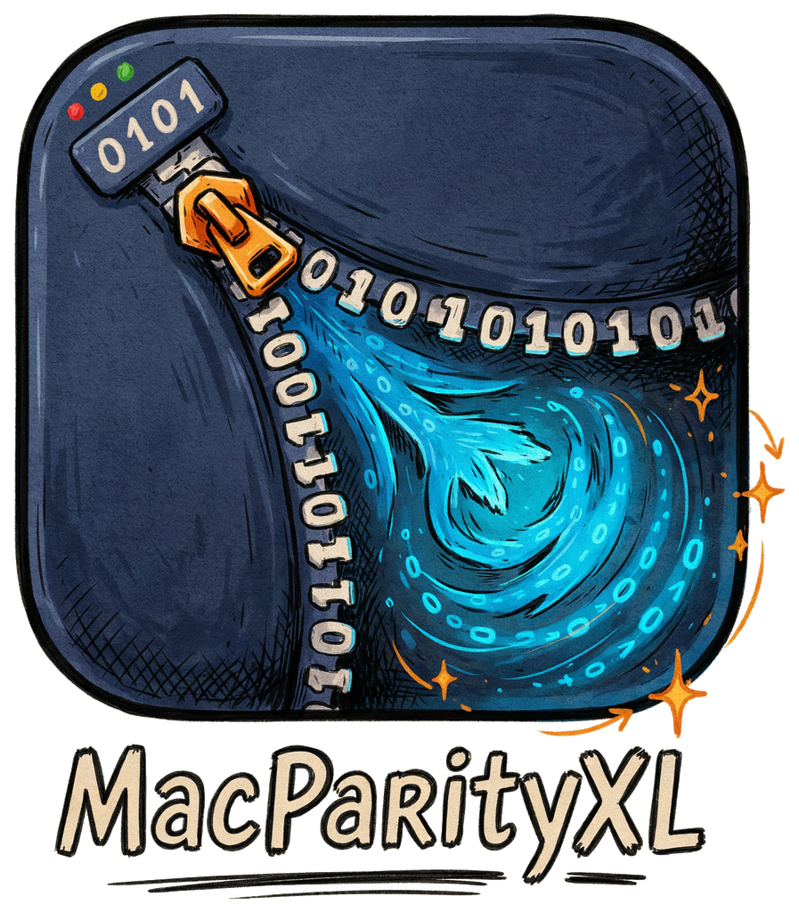

<p align="center"></p>

# MacParityXL

A modern macOS rebuild of MacPAR deLuxe: verify, repair and create PAR2 and PAR1 sets,
extract RAR archives, and run post-processing rules. See [SPEC.md](SPEC.md) for the feature spec.

- **PAR2**: verify, repair (including renamed files) and create, powered by par2cmdline-turbo
- **PAR1**: verify, repair and create with a built-in Swift engine
- **Unrar**: built in (RARLAB UnRAR), multi-volume and password-protected archives, automatically
  after a successful repair
- **Post-processing rules**: open, open with an app, or run a Terminal command after a check
- Universal app (Apple silicon and Intel), macOS 14 or later
- English, German, French, Spanish and Ukrainian; follows the system language, or pick one in
  Settings › General

## Install

Download the DMG from [Releases](../../releases), open it and drag MacParityXL to Applications.

The app is not notarized. On first launch, right-click it and choose **Open**, or allow it under
System Settings › Privacy & Security. Alternatively:

```bash
xattr -dr com.apple.quarantine /Applications/MacParityXL.app
```

## Layout

| Path | What |
|---|---|
| `App/Sources` | AppKit + SwiftUI app (NSDocument per par set, menus in code) |
| `App/CUnrar` | Clang module exposing RARLAB's UnRAR `dll.hpp` to Swift |
| `App/Resources` | App icon and String Catalogs (`Localizable.xcstrings`, `InfoPlist.xcstrings`) |
| `Packages/ParityKit` | Pure Swift core: par2 output parser, PAR2 file reader, PAR1 engine, rules, RAR volume naming |
| `Scripts/bootstrap-vendor.sh` | Downloads (SHA-256 pinned) and builds par2cmdline-turbo and libunrar, universal |
| `Scripts/build-release.sh` | Builds the self-contained, universal app plus DMG and ZIP without Xcode |
| `Scripts/test.sh` | Runs the ParityKit tests (also with only the Command Line Tools) |
| `project.yml` | XcodeGen spec; the `.xcodeproj` is generated |

## Build

```bash
brew install xcodegen
Scripts/bootstrap-vendor.sh
Scripts/build-release.sh      # → build/release/MacParityXL.app, .dmg, .zip
```

For development in Xcode:

```bash
xcodegen generate
open MacParityXL.xcodeproj
```

## License

MacParityXL's own code is MIT licensed, see [LICENSE](LICENSE). The bundled engines keep their licenses:

- par2cmdline-turbo: GPL-2.0, shipped as a separate executable in `Contents/Helpers`.
- UnRAR: RARLAB UnRAR license (extraction only; may not be used to re-create the RAR compression
  algorithm). Linked statically.

Both license texts ship in the app (`Contents/Resources/licenses`) and are linked from the About window.
